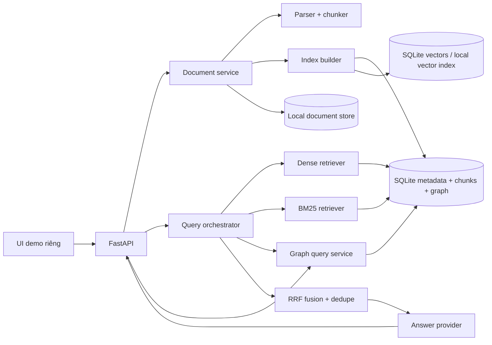

# Kế hoạch triển khai hệ thống RAG độc lập COC DI LAM

**Trạng thái:** Đề xuất triển khai  
**Mục tiêu:** Xây một dịch vụ RAG nhỏ, chạy độc lập, có UI demo riêng và phục vụ tra cứu tri thức của dự án COC DI LAM.

## 1. Mục tiêu và giả định

Hệ thống cho phép nạp tài liệu dự án, đặt câu hỏi bằng tiếng Việt hoặc tiếng Anh, nhận câu trả lời có trích dẫn, đồng thời quan sát và so sánh ba chiến lược:

1. **RAG:** truy xuất ngữ nghĩa bằng vector.
2. **GraphRAG:** tìm thực thể liên quan, mở rộng quan hệ trong đồ thị có giới hạn, rồi lấy các đoạn nguồn làm bằng chứng.
3. **HybridRAG:** hợp nhất kết quả vector, từ khóa và đồ thị.

Các giả định dùng để lập kế hoạch:

- Đây là ứng dụng phát triển và demo nội bộ, ưu tiên chạy local bằng một lệnh.
- Dùng Python/FastAPI và các thư viện sẵn có khi phù hợp; UI độc lập với FE-test/FE-inspect.
- Dữ liệu ban đầu chủ yếu là tài liệu dự án, README, Markdown, văn bản và một số PDF có text layer.
- Corpus ban đầu nhỏ đến vừa; chưa cần dịch vụ vector database, Redis, MinIO hay hệ thống nhiều người dùng.
- LLM và embedding bên ngoài là cấu hình tùy chọn. Mặc định phải hiển thị rõ khi đang dùng baseline offline.
- Không coi kết quả tự sinh từ LLM là dữ kiện đúng nếu không có đoạn nguồn đi kèm.

## 2. Điểm xuất phát trong repo

Repo hiện tại là bản sao đầy đủ của `core_ai_agent`. Phần RAG hiện có là nền tham khảo tốt nhưng vẫn mang ngữ cảnh phỏng vấn:

- `rag/retrievers.py` đã có BM25, dense retrieval, GraphRetriever có giới hạn mở rộng và reciprocal-rank fusion.
- `rag/embedding.py` có LSA offline và adapter embedding neural tùy chọn; `rag/gemini.py` có adapter embedding từ xa.
- `rag/indexing.py`, `rag/storage.py` và `rag/engine.py` xây index, lưu snapshot SQLite và xử lý truy vấn.
- `rag/schemas.py` và `rag/engine.py` mô hình hóa CV, JD, câu hỏi, rubric, interview context và follow-up; đây không phải API tài liệu RAG tổng quát.
- `rag/api.py` chủ yếu cung cấp `/rag/context`, `/rag/follow-up`, trace/session và thao tác index; chưa có thư viện tài liệu và UI hỏi đáp RAG độc lập.
- `rag/parsing.py` chỉ đọc PDF có text layer, TXT và Markdown theo loại CV/JD; chưa phải parser tổng quát.
- `FE-test/` và `FE-inspect/` thuộc Core Studio. `core/`, Redis và MinIO phục vụ runtime phỏng vấn, không nên là phụ thuộc bắt buộc của sản phẩm RAG mới.

### Quyết định tái sử dụng

- Tái sử dụng thuật toán, giao diện provider và ý tưởng version hóa sau khi tách khỏi schema interview.
- Viết domain model, ingestion pipeline, query service, API và UI mới cho hệ thống độc lập.
- Không import `core.*`, không dùng API session interview làm API chính và không yêu cầu Redis/MinIO để chạy demo.
- Giữ bản import làm nguồn tham khảo trong giai đoạn đầu. Chỉ dọn hoặc di chuyển phần không dùng sau khi baseline độc lập chạy được và thay đổi đó được xem xét riêng.

## 3. Phạm vi sản phẩm

### Trong phiên bản đầu

- Nạp tài liệu qua upload và qua một thư mục dự án được allowlist.
- Parser cho `.md`, `.txt`, `.pdf` có text layer; thêm `.py`, `.json`, `.yaml`, `.yml`, `.toml` dạng văn bản để hỏi về repo. File scan/OCR để giai đoạn sau.
- Theo dõi trạng thái nạp, lỗi, hash, phiên bản index và khả năng xóa tài liệu.
- Chunk theo heading/đoạn; lưu page, heading, đường dẫn, số dòng hoặc offset để trích dẫn.
- Ba chế độ truy xuất rõ ràng: Vector RAG, GraphRAG local, HybridRAG.
- Câu trả lời có trích dẫn bấm được để mở đoạn nguồn; từ chối hoặc báo thiếu bằng chứng khi không tìm được nguồn đủ tốt.
- Trang quản lý nguồn, trang hỏi đáp, trang so sánh chế độ và trang xem đồ thị.
- Bộ câu hỏi đánh giá nhỏ có nhãn nguồn đúng để theo dõi thay đổi retrieval.
- Docker Compose local gồm API/UI và volume dữ liệu SQLite/file.

### Chưa thuộc MVP

- Multi-tenant, đăng nhập doanh nghiệp, phân quyền theo người dùng hoặc production internet-facing.
- OCR, crawling web tùy ý, đồng bộ cloud drive, ingest video/audio.
- GraphRAG quy mô lớn với community detection, community report và global search trên hàng triệu node.
- Agent tự hành, ghi dữ liệu vào Core AI Agent, hoặc thay thế retrieval trong interview runtime.
- Cam kết chất lượng nghiệp vụ dựa trên dữ liệu chưa được người dùng duyệt.

## 4. Luồng sử dụng chính

### Nạp dữ liệu

1. Người dùng upload file hoặc chọn một thư mục được cấu hình cho dự án.
2. API kiểm tra loại file, kích thước, hash trùng và đường dẫn; file gốc được lưu an toàn theo ID, không theo tên do client cung cấp.
3. Ingestion job trích xuất text và metadata, chia chunk, tạo embedding, lập chỉ mục từ khóa và trích xuất graph facts.
4. Job lưu trạng thái `queued → processing → ready` hoặc `failed`; lỗi có thông báo đã lọc, có thể retry.
5. Khi hoàn tất, phiên bản index mới được kích hoạt nguyên tử; truy vấn đang chạy vẫn dùng snapshot cũ đến khi kết thúc.

### Hỏi và xem bằng chứng

1. Người dùng nhập câu hỏi, chọn `RAG`, `GraphRAG` hoặc `HybridRAG`, số nguồn và bộ lọc.
2. Hệ thống chạy các kênh truy xuất theo mode, lưu trace gọn gồm query, index version, kênh, thứ hạng, điểm, thời gian và nguồn.
3. Hệ thống tạo câu trả lời chỉ từ đoạn bằng chứng đã truy xuất. Mỗi trích dẫn liên kết đến file, trang/heading/vị trí và đoạn text.
4. Nếu không có bằng chứng đạt ngưỡng, UI báo không đủ dữ liệu thay vì tự điền kiến thức ngoài corpus.
5. Người dùng có thể chạy cùng câu hỏi trên cả ba mode và đối chiếu nguồn, độ phủ, latency.

## 5. Kiến trúc đích

### Thành phần

- **`src/cocdilam_rag/api/`:** FastAPI routers, request/response schemas, health/readiness.
- **`src/cocdilam_rag/services/`:** ingestion jobs, index lifecycle, query orchestration, answer generation, evaluation.
- **`src/cocdilam_rag/retrieval/`:** dense, sparse, graph retrievers, rerank hooks và fusion.
- **`src/cocdilam_rag/providers/`:** embedding và LLM ports/adapters; luôn trả provider/model signature.
- **`src/cocdilam_rag/storage/`:** SQLite repositories, file store, migrations và index snapshots.
- **`ui/`:** static HTML/CSS/JS độc lập, cùng origin với API để giảm cấu hình CORS.
- **`data/`:** database, file upload và cache runtime; phải nằm trong `.gitignore`.
- **`tests/`:** unit, API/integration và bộ đánh giá retrieval có ground truth.

Không cần microservices. Một FastAPI process và một worker ingestion đơn giản là đủ cho quy mô demo. Job trạng thái cần ghi SQLite để UI đọc được sau reload; khi process khởi động lại, job đang dở được đánh dấu retryable/failed rõ ràng, không giả vờ hoàn tất.

## 6. Định nghĩa ba chế độ retrieval

### Vector RAG

- Embed câu hỏi bằng cùng provider/signature đã dùng khi index.
- Tìm top-k chunk theo cosine similarity; áp dụng metadata filters trước khi trả kết quả.
- Có ngưỡng relevance cấu hình được; hiển thị score và provider trong trace.
- LSA offline được gắn nhãn baseline lexical-semantic, không mô tả như embedding neural chất lượng cao.

### GraphRAG local

- Xây node thực thể, alias, loại node; edge có loại quan hệ, confidence, chunk nguồn và evidence span.
- Khởi đầu bằng ontology nhỏ cho COC DI LAM (project/module/API/data model/requirement/technology) cộng alias từ tài liệu.
- Có `GraphExtractor` interface: extractor quy tắc/ontology chạy offline; extractor LLM có cấu hình chỉ bật rõ ràng, có giới hạn và giữ nguyên provenance.
- Query nhận diện entity seeds, duyệt lân cận có giới hạn số hop, số node, thời gian và fan-out; sau đó lấy chunk gốc của node/edge làm evidence.
- Mỗi đường đi hiển thị quan hệ và nguồn. Không biến quan hệ suy luận thành sự thật nếu thiếu câu trích dẫn.
- MVP chỉ hứa hẹn **local GraphRAG**. Global/community summaries để giai đoạn sau nếu corpus và bộ đánh giá chứng minh cần thiết.

### HybridRAG

- Chạy song song BM25, vector và graph (khi query có entity seed phù hợp).
- Lọc theo document/project trước khi hợp nhất; chuẩn hóa định danh chunk và loại trùng.
- Hợp nhất bằng weighted RRF với smoothing `k` cấu hình được; trả cả thứ hạng từng kênh và điểm fused để giải thích kết quả.
- Mặc định trọng số cân bằng, sau đó chỉ hiệu chỉnh bằng bộ câu hỏi có nhãn. Không đặt trọng số theo cảm tính mà không lưu cấu hình.

Ba mode dùng chung bộ lọc, answer generator, citation schema, telemetry và quy tắc abstain để so sánh công bằng.

## 7. Ingestion, chunking và lưu trữ

### Pipeline và tính lặp an toàn

- File ID riêng; SHA-256 phát hiện file giống hệt. Re-ingest có thể bỏ qua hoặc tạo revision theo lựa chọn.
- MIME/suffix allowlist, giới hạn kích thước và số trang/bytes sau giải nén; tên lưu nội bộ opaque.
- Parser không chạy macro/script; không thực thi nội dung source code.
- Chunk Markdown theo heading và paragraph, source code theo file và giới hạn dòng, PDF theo trang rồi ghép đoạn có overlap nhỏ.
- Lưu `document_id`, `chunk_id`, ordinal, page/heading, start/end offset hoặc line range, hash, index version.
- Thay đổi parser/chunker/embedding signature tạo index version mới. Build xong mới đổi active pointer trong transaction.
- Xóa document phải loại chunks, vectors, entities/edges chỉ thuộc tài liệu đó và refresh index; UI xác nhận hậu quả trước xóa.

### Cấu trúc dữ liệu tối thiểu

| Bảng | Trường chính |
|---|---|
| `documents` | `id`, `name`, `source_type`, `mime`, `sha256`, `status`, `created_at`, `error`, `active_revision` |
| `ingest_jobs` | `id`, `document_id`, `status`, `progress`, `started_at`, `finished_at`, `error_code` |
| `chunks` | `id`, `document_id`, `revision`, `ordinal`, `text`, `page`, `heading`, `line_start`, `line_end`, `content_hash` |
| `embeddings` | `chunk_id`, `provider_signature`, `dimensions`, `vector_blob` |
| `entities` | `id`, `canonical_name`, `entity_type`, `aliases_json` |
| `entity_mentions` | `entity_id`, `chunk_id`, `start_offset`, `end_offset`, `confidence` |
| `relations` | `id`, `source_entity`, `relation`, `target_entity`, `chunk_id`, `evidence`, `confidence` |
| `query_runs` | `id`, `mode`, `question`, `index_version`, `settings_json`, `timing_json`, `created_at`, `expires_at` |
| `query_hits` | `query_id`, `chunk_id`, `channel`, `rank`, `score`, `graph_path_json` |

Đường dẫn file runtime, database, embeddings cache, `.env`, token và nội dung upload không được commit vào Git. Nếu sau này bật LLM/embedding remote, cấu hình phải cho biết rõ dữ liệu nào rời máy local.

## 8. API dự kiến

Prefix `/api/v1` và schema có version:

- `GET /health/live`, `GET /health/ready`: sống/ready, SQLite và index active, provider signatures; không trả secrets.
- `GET /documents`: danh sách, trạng thái, filter và phân trang.
- `POST /documents`: multipart upload, trả document ID và job ID.
- `POST /documents/{id}/ingest`: re-index; `DELETE /documents/{id}`: xóa document.
- `GET /jobs/{id}`: tiến độ ingest.
- `POST /search`: query, mode, top-k, filters; trả hits theo channel và nguồn.
- `POST /answers`: query, mode và answer options; trả answer, citations, abstain flag và trace ID.
- `GET /queries/{id}`: truy vấn trace/result đã lọc dữ liệu nhạy cảm.
- `GET /graph/summary`, `GET /graph/entities/{id}`: thống kê và lân cận graph bị giới hạn.
- `POST /evaluation/runs`: chạy bộ câu hỏi local; endpoint chỉ bật ở chế độ dev/admin.

Upload/index/delete/evaluation là thao tác quản trị. Demo mặc định bind loopback; nếu mở ra LAN cần API token, hạn mức request, CORS cụ thể và hướng dẫn rõ là chưa dành cho production.

## 9. UI demo riêng

### Trang 1 — Sources

- Upload file, thêm đường dẫn trong thư mục allowlist, danh sách nguồn và trạng thái ingest.
- Hiển thị số trang/bytes/chunks/entities, lỗi có thể retry, hash rút gọn và thời gian cập nhật.
- Xóa một nguồn và giải thích rằng các kết quả phụ thuộc nguồn đó sẽ biến mất khỏi index mới.

### Trang 2 — Ask

- Ô hỏi đáp, selector ba mode, top-k và filter theo tài liệu.
- Hiển thị câu trả lời, trạng thái đủ/thiếu bằng chứng, citations mở đoạn nguồn, metadata nguồn và thời gian.
- Disclosure “retrieval trace” cho dense/sparse/graph paths và version index.

### Trang 3 — Compare

- Chạy cùng query trên ba mode, hiển thị câu trả lời, thứ tự chunks, overlap và latency.
- Làm rõ đây là so sánh retrieval trên cùng corpus/câu hỏi; một câu trả lời đẹp hơn không đồng nghĩa đúng hơn.

### Trang 4 — Graph

- Xem entity/relationship neighborhood bằng đồ thị nhỏ tương tác hoặc danh sách có thể mở rộng.
- Click node/edge sẽ mở evidence chunk. Giới hạn số node để không làm rối màn hình.

### Trang 5 — Evaluation/Settings

- Chọn embedding/LLM provider đã cấu hình, chunk size, overlap, retrieval limits và RRF weights.
- Chạy bộ câu hỏi đánh giá; xem recall@k, MRR, citation coverage, abstention và latency theo mode.
- Không cho nhập API secret vào browser local storage; secrets chỉ đọc từ environment/config phía server.

## 10. Lộ trình triển khai theo giai đoạn

### Giai đoạn 0 — Chốt nền và inventory

**Thực hiện:** xác nhận phạm vi local demo, nguồn tài liệu COC DI LAM, giới hạn file, provider mặc định; ghi lại module nào có thể tái sử dụng và module nào interview-specific. Tạo một bộ corpus mẫu nhỏ đã được phép dùng và 20–30 câu hỏi có nguồn đúng để đánh giá.

**Hoàn tất khi:** có manifest nguồn ban đầu, bộ câu hỏi/đáp án có trích dẫn được duyệt, giới hạn dữ liệu và tiêu chí nghiệm thu được chốt; repo có điểm baseline dễ khôi phục.

### Giai đoạn 1 — Khung ứng dụng độc lập

**Thực hiện:** tạo package `src/cocdilam_rag`, settings/env example, SQLite migration đầu tiên, FastAPI health/readiness, static UI shell riêng, Docker Compose chạy API/UI một origin và volume local. Đặt tên package/project đúng `RAG_CocDiLam`; đảm bảo không cần khởi tạo core interview, Redis hay MinIO.

**Hoàn tất khi:** cài dependency sạch, app chạy bằng lệnh được ghi trong README, health báo trạng thái index/provider đúng, và FE-test/FE-inspect không bị dùng làm UI RAG.

### Giai đoạn 2 — Document intake và index lifecycle

**Thực hiện:** upload PDF/TXT/MD và text source files; validate, hash, parser, chunker, persisted job status, index versioning, retry, delete và allowlisted folder ingest. Tạo sample corpus từ tài liệu dự án đã chọn, không tự ingest `.env`, `.git`, `data` runtime, binary, dependency folder hay secrets.

**Hoàn tất khi:** file trùng xử lý idempotent; citation locator giữ được page/heading/line; file lỗi không làm hỏng active index; reindex switch nguyên tử; UI phản ánh đúng job/document state.

### Giai đoạn 3 — Vector RAG và grounded answers

**Thực hiện:** triển khai embedding provider port; dùng LSA offline làm baseline có nhãn, thêm neural/remote adapter tùy cấu hình; dense retrieval, metadata filters, top-k và score thresholds. Xây answer prompt có ranh giới rõ giữa instructions và untrusted retrieved text; chuẩn hóa citations và abstention.

**Hoàn tất khi:** mỗi citation trỏ về đúng chunk/file, không sinh citation giả; thiếu evidence thì abstain; đổi embedding signature tự rebuild index; UI cho thấy provider đang chạy và latency.

### Giai đoạn 4 — GraphRAG local

**Thực hiện:** định nghĩa ontology nhỏ cho thuật ngữ dự án, alias resolution, entity mention/evidence, relation schema, graph extraction port và graph neighborhood retriever có timeout/hop/fan-out limits. Bắt đầu bằng ontology/rule facts từ corpus, sau đó thêm extractor LLM có opt-in và provenance.

**Hoàn tất khi:** câu hỏi về quan hệ nhiều bước tạo được graph path có dẫn chứng; node/edge không có nguồn bị loại khỏi answer context; graph traversal có giới hạn và trace giải thích seeds, hops, node counts, truncation.

### Giai đoạn 5 — HybridRAG và hiệu chỉnh retrieval

**Thực hiện:** thêm BM25/sparse channel, chạy dense+sparse+graph song song, RRF, dedupe, filters chung, channel diagnostics. Dùng bộ câu hỏi đã duyệt để thử các weight/config khác nhau và lưu kết quả benchmark.

**Hoàn tất khi:** cùng query trả top-k và rank từng channel; `HybridRAG` có thể giải thích đóng góp từng hit; benchmark so sánh được với Vector RAG và GraphRAG trên cùng tập câu hỏi.

### Giai đoạn 6 — Hoàn thiện UI demo

**Thực hiện:** hoàn thiện Sources, Ask, Compare, Graph và Evaluation/Settings; thêm loading/error/empty states, responsive layout cơ bản, Vietnamese-first wording, hiển thị citations và trace. Không expose secret trong client.

**Hoàn tất khi:** người mới có thể nạp tài liệu, hỏi ở từng mode, click citations, mở graph path, so sánh ba mode và xem benchmark mà không dùng Swagger/terminal.

### Giai đoạn 7 — Hardening local demo và bàn giao

**Thực hiện:** kiểm thử parser, tenant/local access boundary, prompt injection, file limits, malformed PDF, oversized graph, provider outage, index rollback, deletion, restart recovery; kiểm tra Docker Compose và hướng dẫn backup/reset local data. Viết README quickstart, kiến trúc, env, limitations và demo script.

**Hoàn tất khi:** nghiệm thu các tiêu chí mục 12; có hướng dẫn chạy, reset và tái tạo demo; limitations được ghi đúng; không tuyên bố production-ready.

## 11. Kế hoạch kiểm thử và đo chất lượng

Trong quá trình triển khai, bổ sung kiểm tra theo từng lớp:

- **Unit:** chunk boundaries/locators, hash/idempotency, provider signatures, RRF/dedup, graph bounds, citation validation, abstention thresholds.
- **API:** upload/status/delete, filters, invalid modes, validation, access boundary, error contracts, limits.
- **Integration:** ingest → active index → query từng mode → citations → delete/re-index; restart khi có job dở.
- **Security:** path traversal, spoofed MIME, oversized/chunked upload, prompt injection trong tài liệu, secret redaction, loopback/token behavior.
- **Retrieval benchmark:** Recall@5, MRR@5, citation coverage, answerable-question abstention và latency; báo theo mode và theo ngôn ngữ.
- **UI smoke:** hoàn tất luồng nạp → hỏi → mở nguồn cho cả ba mode.

Tập 20–30 câu hỏi đầu cần có đáp án mong đợi, chunk/document nguồn và nhãn `answerable/unanswerable`; một người phụ trách COC DI LAM duyệt nguồn và ground truth. Số liệu benchmark ban đầu là baseline, không phải bằng chứng chất lượng rộng nếu tập đánh giá nhỏ.

## 12. Tiêu chí nghiệm thu MVP

- Chạy local từ README bằng một workflow thống nhất; không cần Core interview service, Redis hoặc MinIO.
- Nạp được tài liệu PDF có text, TXT, Markdown và allowlisted text source files; lỗi parser không làm mất index đang hoạt động.
- Nạp lặp file giống nhau không nhân đôi chunks ngoài lựa chọn revision rõ ràng.
- Cả ba mode chạy trên cùng corpus và trả top-k chunks có source locator.
- Hybrid trace thể hiện kết quả dense, BM25, graph và điểm RRF; GraphRAG hiển thị ít nhất một loại đường quan hệ có evidence.
- Answer citation validation bảo đảm mọi trích dẫn thuộc query result; không có bằng chứng phù hợp thì hệ thống trả lời thiếu dữ liệu.
- UI độc lập có Sources, Ask, Compare, Graph và Evaluation; các state lỗi/đang xử lý/rỗng được thể hiện.
- Bộ đánh giá tạo được báo cáo Recall@k/MRR/citation coverage/latency theo mode, có ghi phiên bản index và provider.
- Có giới hạn upload/traversal, dữ liệu runtime bị ignore bởi Git, secrets không xuất ra UI/log/health response.
- README nêu rõ offline baseline, remote provider behavior, không có OCR, local-demo security boundary và việc GraphRAG hiện là local/bounded.

## 13. Rủi ro và cách giảm thiểu

| Rủi ro | Cách xử lý |
|---|---|
| LSA offline không đủ ngữ nghĩa cho câu hỏi tiếng Việt/Anh | Giữ BM25 trong Hybrid, đo benchmark, cho phép neural provider; ghi rõ baseline và model signature. |
| Graph extraction tạo quan hệ sai hoặc thiếu | Mỗi quan hệ cần evidence span/confidence; ontology/rules trước, LLM extraction là opt-in và có review path. |
| Tài liệu chứa prompt injection hoặc chỉ dẫn độc hại | Xem toàn bộ nội dung retrieval như dữ liệu không tin cậy; answer prompt không thực thi chỉ dẫn trong nguồn; citations bắt buộc. |
| Index rebuild gây downtime hoặc hỏng snapshot | Build snapshot riêng, validate, activate nguyên tử; giữ bản active trước để rollback. |
| Nạp nhầm secret hoặc dữ liệu riêng tư | Allowlist nguồn, ignore `.env`/secret patterns, log metadata tối thiểu, local-only mặc định; remote provider phải được chọn rõ ràng. |
| Scope nở thành nền tảng production | Chốt MVP theo mục 3; không thêm vector DB, multi-tenant hoặc global GraphRAG trước khi demo/evaluation chứng minh cần. |
| Copy cũ gây nhầm giữa RAG demo và interview runtime | Package/service/API mới, README mới, lệnh chạy riêng và không import `core.*`; dọn legacy trong thay đổi riêng sau khi xác nhận. |

## 14. Ước lượng và thứ tự ưu tiên

Ước lượng sơ bộ cho một developer, với corpus mẫu và provider đã sẵn sàng: khoảng **3–5 tuần làm việc**. Phần không chắc chắn lớn nhất là chất lượng graph extraction và giao diện xem trace; nếu giới hạn GraphRAG ở ontology/local traversal như MVP, phần này giảm đáng kể. Thứ tự ưu tiên là:

1. Standalone app + ingest + vector RAG + citations.
2. BM25 + HybridRAG + benchmark.
3. GraphRAG local có evidence, sau đó Compare/Graph UI.
4. Hardening, docs và demo acceptance.

Nếu cần demo sớm, có thể hoàn thành một lát cắt đầu tiên gồm upload Markdown/PDF, Vector RAG, citations và một trang Ask trước; không nên trì hoãn lát cắt đó để xây graph tổng quát.

## 15. Definition of Done

MVP hoàn tất khi một người khác clone repo, làm theo README, nạp bộ dữ liệu demo, chạy cùng một tập câu hỏi trên Vector RAG/GraphRAG/HybridRAG, thấy câu trả lời có nguồn hoặc abstain, mở được đường dẫn graph và báo cáo đánh giá; mọi giới hạn, provider, nguồn dữ liệu và cấu hình index đều hiển thị hoặc được ghi trong trace.
