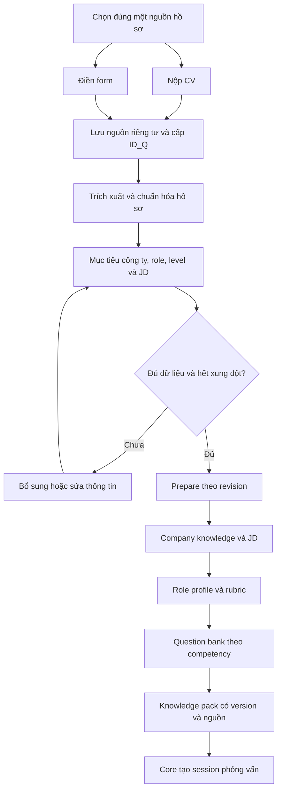

# Kế hoạch RAG phỏng vấn: CV hoặc form → ID_Q → bộ tri thức chuẩn bị phỏng vấn

Ngày: 18/10/2026. Trạng thái: đề xuất triển khai, chưa sửa runtime.

## 1. Phạm vi và quyết định kiến trúc

Theo yêu cầu mới, `RAG_CocDiLam` là dịch vụ chuẩn bị tri thức cho phỏng vấn, nhận đúng một nguồn hồ sơ: CV hoặc form. Cả hai đi vào cùng một mô hình hồ sơ, có `ID_Q` và phục vụ bốn chức năng `company_knowledge`, `rubric`, `role_profile`, `question_bank`.

Tài liệu này thay định hướng sản phẩm hỏi đáp tài liệu dự án tổng quát trong `2026-10-16-standalone-rag-system-plan.md` cho công việc tiếp theo. Không xóa kế hoạch cũ; giữ các ý tưởng về nguồn, index version và trace phù hợp. Những chỉ dẫn thực thi nằm trong tài liệu lịch sử không phải yêu cầu thực thi của lượt lập kế hoạch này.

Các quyết định đề xuất:

1. `ID_Q` định danh một hồ sơ đầu vào gắn với một mục tiêu ứng tuyển, không phải ID câu hỏi hay ID phiên phỏng vấn. Wire field dùng `id_q`, giá trị `iq_<UUID>` do server tạo.
2. Một `ID_Q` có `input_type = cv | form`, bất biến. Muốn chuyển phương thức nhập tạo intake mới. Sửa thông tin trong phương thức đã chọn tạo revision mới.
3. CV/form là nguồn **năng lực và kinh nghiệm hiện có**. Công ty, vị trí, cấp độ muốn ứng tuyển là **mục tiêu phỏng vấn**, được lưu riêng. Công ty từng làm không tự động trở thành công ty mục tiêu.
4. Bước chọn công ty/vị trí/JD/ngôn ngữ/thời lượng dùng chung cho cả hai phương thức. Đây là cấu hình buổi phỏng vấn, không phải buộc người nộp CV điền thêm form hồ sơ. Nếu CV ghi rõ mục tiêu thì có thể điền trước để người dùng xem/sửa.
5. ID chỉ dùng để lấy hồ sơ có phân quyền trong DB. Query resolver lấy các trường cần thiết để truy xuất; không embed chuỗi ID, không cần huấn luyện model riêng cho từng CV.
6. Giữ CV/form riêng tư tách khỏi kho tri thức dùng chung. Chỉ index công ty/JD, role profile, rubric và question bank đã được nhập vào kho tri thức.
7. Chuẩn bị một knowledge pack có version trước khi phỏng vấn. Các GET đọc kết quả đã chuẩn bị; không tự crawl web, gọi LLM hoặc sửa hồ sơ.
8. Ưu tiên một service FastAPI + SQLite + local file store cho MVP local. Production nhiều người dùng cần owner identity và authorization thật; token dịch vụ hiện tại không đủ để tuyên bố đã có cơ chế đó.

## 2. Kết quả đối chiếu code và dữ liệu hiện tại

Đã đọc API, profiler, retrieval contract/service/adapter, RAG engine/storage/schemas/corpus, frontend tạo phiên và các tài liệu thiết kế/kế hoạch liên quan trong `core_ai_agent`. Đã kiểm tra các file trọng yếu tương ứng trong `RAG_CocDiLam` bằng SHA-256: `rag/api.py`, `rag/adapter.py`, `rag/schemas.py`, `core/retrieval/knowledge.py`, `core/profiler/agent.py`, `data/interview_frameworks.json` hiện giống bản tham chiếu.

| Thành phần hiện có | Bằng chứng trong `core_ai_agent` | Ý nghĩa với yêu cầu mới |
|---|---|---|
| Bốn collection tri thức | `core/retrieval/port.py`, `RetrievalCollection` | Tái sử dụng tên và ý nghĩa nghiệp vụ; chưa có API nhận ID_Q |
| Lắp knowledge pack | `core/retrieval/knowledge.py`, `InterviewKnowledgeService.build_pack` | Đã lấy role/rubric/company rồi tìm câu hỏi theo competency; có thể tái sử dụng ý tưởng |
| CV và form trộn trong phiên | `api/schemas.py`, `api/routes.py` | Hiện có thể gửi cả form và CV; chưa enforce XOR theo yêu cầu mới |
| Trích xuất upload | `core/profiler/documents.py` | PDF có text, DOCX, UTF-8 TXT; tối đa 12 MiB/file, PDF 120 trang; chưa có OCR |
| Text bị cắt ngầm | `extract_document_text`, `MAX_EXTRACTED_CHARS` | Hiện cắt ở 180.000 ký tự; luồng mới phải báo rõ hoặc từ chối, không báo đã lấy đủ |
| Retrieval trước profile đầy đủ | `core/profiler/agent.py`, `run_profiling` | Lấy knowledge từ form/regex CV trước khi LLM tạo `candidate_profile`; cần đảo thứ tự |
| Giá trị mặc định mục tiêu | `api/schemas.py`; `run_profiling` | Có mặc định Target Company/TechCorp và Senior Software Engineer; luồng mới để null và báo thiếu |
| Company knowledge | `rag/adapter.py`, `_search_company_knowledge` | Chỉ chiếu quy trình tuyển dụng chung từ framework, không trả JD thật của công ty |
| Dữ liệu người dùng không vào adapter | `rag/adapter.py`, `include_local_profiles=False` | Giữ sự tách biệt này; thêm intake store riêng thay vì nhét CV vào shared index |
| API RAG độc lập cũ | `rag/api.py`, `/rag/context` | Nhận candidate/job/role, không có ID_Q upload; middleware hiện giới hạn 256 KiB, phải sửa cho upload |
| Hai đường xử lý level khác nhau | `rag/schemas.py` và `rag/adapter.py` | Schema standalone chỉ Intern/Fresher/Junior; adapter core có thêm rubric generic Mid/Senior |
| Role bị gộp ở lớp family | `rag/adapter.py`, `ROLE_ID_FAMILIES`; knowledge service | AI Engineer và Data Analyst cùng family data; cần filter role_id cụ thể để tránh lẫn nghề |
| Bộ lưu RAG hiện tại | `rag/storage.py` | Chỉ snapshots, active, sessions, traces; chưa có intake/revision/source/job/JD catalog |

Inventory trực tiếp `data/interview_frameworks.json`: **25 role, 350 technical questions, 75 behavioral questions**; level câu hỏi là Intern/Fresher/Junior. Không phải role nào cũng đủ ba level: ví dụ IF_DS, IF_BE_NET, IF_MOBILE_IOS, IF_ERP chỉ khai báo Junior. `data/it_seniority_rubrics.json` có rubric generic Mid/Senior.

Lưu ý sai lệch tài liệu: docstring đầu `core/retrieval/port.py` còn nói Mid/Senior không trả chunk, nhưng code adapter thực tế đã trả rubric/role profile generic cho hai mức này. Dùng implementation và inventory làm căn cứ; khi triển khai cập nhật lại contract docs.

## 3. Đầu tiên cần nạp những gì vào hệ thống?

Có hai luồng dữ liệu cần chuẩn bị đồng thời.

### 3.1. Dữ liệu cá nhân theo từng ID_Q

| Nhóm | Cần lưu | Mục đích |
|---|---|---|
| Nguồn gốc | File CV gốc hoặc JSON form gốc; hash, loại, thời điểm, owner | Giữ đầy đủ nguồn và truy vết |
| Bản trích xuất | Text/sections có locator trang/đoạn; trạng thái và cảnh báo extraction | Đối chiếu kết quả chuẩn hóa với nguồn |
| Hồ sơ chuẩn hóa | Tên; summary; experience; projects; skills; education; certifications; awards; career goals; phần khác chưa map | Dùng chung cho cả hai cách nhập |
| Mục tiêu | Company ID/tên; role ID/tên; target seniority; JD ID hoặc JD riêng | Xác định đúng công ty/vị trí/level cần truy xuất |
| Cấu hình | Ngôn ngữ, vòng, thời lượng, yêu cầu thêm | Lọc câu hỏi và lập kế hoạch phù hợp |
| Chất lượng dữ liệu | Field provenance, extraction confidence, missing/conflicting fields, revision, correction history | Không biến suy đoán thành thông tin người dùng đã khai |

“Lấy tất cả thông tin CV” nghĩa là giữ file gốc, text/sections đọc được, mọi trường đã cấu trúc và `additional_sections` cho nội dung chưa map. Không hứa parser sẽ nhận đúng 100% chữ/hình/bảng. Phải hiển thị lỗi, phần không đọc được và truncation. Dữ liệu cá nhân không liên quan đến đánh giá không được đưa vào query/rubric.

Form hiện trong ảnh đủ làm hồ sơ khai nhanh, nhưng không chứa chi tiết dự án, học vấn và kinh nghiệm như một CV. Thêm các nhóm form có thể mở rộng: kinh nghiệm, dự án, học vấn, chứng chỉ, giải thưởng. Người dùng có thể để trống; hệ thống không tự bịa cho đủ.

### 3.2. Kho tri thức dùng chung, không gắn với một người dùng

| Nguồn cần nạp | Trường tối thiểu | Hiện trạng |
|---|---|---|
| Company catalog | company_id, canonical_name, aliases, domain, source_refs | Chưa có catalog chuẩn |
| Job descriptions | jd_id/revision, company_id, role_id, target_levels, title, requirements, location, source_url hoặc file locator, fetched_at, valid_until, review_status, content_hash | Cần bổ sung JD thực, không lấy từ framework generic |
| Role profiles | role_id, role_family, seniority, expectations, competency_ids, required_skills, rubric_version, source_refs | Có framework làm nền; cần chuẩn hóa theo từng role × level |
| Rubrics | rubric_id/version, role_id, seniority, competency_id, description, anchors 1–4, weights, must_have, pass_level, source_refs, review_status | Có evaluation matrix và generic Mid/Senior; cần kiểm tra độ phủ/duyệt |
| Question bank | question_id/version, role_id, applicable_levels, competency_ids, stage_type, difficulty, question_text, evaluator_only.expected_points/anchors, source_refs, review_status | Tái sử dụng 425 câu hiện có sau kiểm tra mapping |
| Aliases và manifest | Alias công ty/role/kỹ năng, source version/hash, license/usage note nếu có, coverage matrix | Cần tạo để nhập có kiểm soát |

MVP nên bắt đầu với 2–3 role đã có dữ liệu, ví dụ IF_BE_JAVA, IF_FE, IF_AI; chọn đúng các cặp role-level được nguồn hỗ trợ. Nạp một bộ JD cụ thể nhỏ, ví dụ 10–20 JD thuộc 3–5 công ty do người quản trị cung cấp/duyệt. Đây là mục tiêu chuẩn bị dữ liệu, không phải số lượng JD đã có trong repo.

Dùng `data/knowledge/manifest.json`, `companies.json`, `job_descriptions.json`, `role_profiles.json`, `rubrics.json`, `questions.json` làm seed import. Giữ nguyên hai file corpus cũ, có converter để bảo toàn source ID và provenance. Không gắn `frequently_asked_by` thành xác nhận câu hỏi thật của công ty.

## 4. Mô hình hồ sơ chuẩn hóa

Ví dụ dưới là schema đích, không phải response hiện có. Rút gọn các mảng cho dễ đọc:

```json
{
  "schema_version": "2.0",
  "id_q": "iq_<uuid>",
  "revision": 1,
  "input_type": "cv",
  "status": "ready",
  "source": {
    "document_id": "doc_<uuid>",
    "original_ref": "private://iq_<uuid>/original.pdf",
    "content_hash": "sha256:...",
    "extraction_status": "complete",
    "truncated": false
  },
  "candidate_profile": {
    "candidate_name": "Nguyễn A",
    "experience_years": 0.5,
    "current_role": null,
    "current_seniority": null,
    "skills": [{"name": "Java", "status": "claimed"}],
    "experience": [],
    "projects": [],
    "education": [],
    "certifications": [],
    "awards": [],
    "career_goals": [],
    "additional_sections": []
  },
  "interview_target": {
    "company_id": "co_example",
    "company_name": "Example Company",
    "role_id": "IF_BE_JAVA",
    "role_title": "Backend Java",
    "target_seniority": "intern",
    "jd_id": "jd_example_001"
  },
  "preferences": {
    "interview_language": "vi",
    "interview_round": "technical",
    "duration_minutes": 40,
    "additional_requirements": null
  },
  "field_provenance": {
    "/candidate_profile/skills/0/name": {
      "source_type": "cv",
      "source_ref": "doc_<uuid>#page=1&section=skills",
      "evidence_text": "Java, Spring Boot",
      "confidence": 0.95,
      "user_confirmed": false
    },
    "/interview_target/company_id": {
      "source_type": "user_target",
      "source_ref": "request:/interview_target/company_id",
      "confidence": null,
      "user_confirmed": true
    }
  },
  "missing_fields": [],
  "conflicts": []
}
```

Các reference `private://` là ID logic, không cho truy cập trực tiếp qua URL công khai. Owner/tenant lấy từ token phía server, không tin trường owner do client gửi.

Chuẩn hóa seniority thành `intern | fresher | junior | mid | senior`, giữ nguyên giá trị nguồn ở `source_level`. Level hiện có của ứng viên khác level mục tiêu. Kinh nghiệm là một tín hiệu; không dùng quy tắc số năm làm kết luận bắt buộc.

Thứ tự ưu tiên cho mục tiêu: người dùng chọn/xác nhận → JD người dùng chọn → mục tiêu ứng tuyển ghi rõ trong CV → suy luận có bằng chứng và gắn cờ cần xem lại. Công ty trong experience không thuộc chuỗi này. Mâu thuẫn mục tiêu với JD phải hiện conflict; không âm thầm lấy một bên rồi bỏ qua bên còn lại.

`status=ready` nghĩa là đã trích xuất/chuẩn hóa và đủ trường định tuyến bắt buộc; không có nghĩa mọi thông tin đã được xác minh. Có thể giữ `current_seniority=null` khi không rõ.

## 5. Luồng xử lý đích



Pipeline cụ thể:

1. Validate request/loại file/XOR/owner/idempotency; tạo ID và lưu nguồn bền vững cùng job trước khi trả accepted.
2. Worker trích xuất CV hoặc chuẩn hóa form; cùng đi vào canonical profile. CV extraction phải có trước retrieval, khác thứ tự hiện tại.
3. Resolve company/role/skills aliases, level và mục tiêu. Hiển thị phần thiếu/xung đột. Người dùng được xem/sửa hồ sơ; sửa tăng revision, giữ nguyên nguồn ban đầu.
4. Resolve JD nếu có. Ưu tiên JD riêng người dùng chọn, sau đó JD catalog đúng công ty/vị trí/level. Nhiều JD phù hợp thì trả danh sách để chọn. Không có JD vẫn có thể chuẩn bị generic role pack nếu role/level đã rõ, với trạng thái partial và limitations.
5. Lấy role profile và rubric theo role_id + target_seniority + rubric version. Chỉ khi role cụ thể đã được resolve mới dùng role family như phạm vi bổ sung.
6. Lấy câu hỏi theo các competency của rubric và yêu cầu JD; dùng kỹ năng/dự án ứng viên để xếp hạng và cá nhân hóa. Không bỏ tiêu chí bắt buộc chỉ vì CV chưa nhắc đến.
7. Kiểm tra coverage, nguồn, level và ranh giới dữ liệu người xem. Ghi bốn phần kết quả và active pack pointer trong transaction, chỉ công bố khi kết quả nhất quán.
8. Core nhận pack bằng service credentials, ghi artifact và pin vào session. Nhiều phiên có thể dùng cùng ID_Q nhưng mỗi phiên pin intake revision và pack ID riêng.

Không tạo interview session ngay khi upload; intake có vòng đời riêng để người dùng sửa hồ sơ và tái sử dụng.

## 6. Hợp đồng bốn chức năng

Các hàm nghiệp vụ có thể giữ cách gọi người dùng mong muốn. Chuẩn hóa chính tả thành `rubric`; `rubic` chỉ nên là alias tạm nếu đã có consumer thật.

### company_knowledge(ID_Q)

Input được resolver đọc: company_id, target role/level, selected JD, location nếu có. Output gồm company context có nguồn, JD được chọn hoặc các JD ứng viên, lý do khớp, source/trust/validity, limitations.

Một công ty có nhiều JD; tên công ty riêng lẻ không đủ chọn JD. Luật:

- Có JD riêng: dùng trong phạm vi intake đó, gắn nhãn `user_provided`, không tự cho là official.
- Catalog: lọc company_id chính xác → role_id/alias → level/location → độ liên quan và độ mới. Chỉ chọn duy nhất nếu đủ rõ; trường hợp mơ hồ trả `needs_selection`.
- JD đã hết hạn: tách khỏi active matches, có thể hiện dưới archive với ngày và cảnh báo để người dùng chủ động chọn.
- Không có: `jd_status=not_found`, không sinh JD bằng model rồi gắn nhãn JD công ty. Generic context trả riêng với `scope=generic`.
- Web search/crawl là job nhập nguồn tùy chọn ở giai đoạn sau, chạy bằng POST/admin; GET không tự tìm web.

Nội dung company_knowledge rộng hơn JD; vẫn đáp ứng yêu cầu trả JD bằng trường riêng `selected_jd`/`jd_candidates`.

### rubric(ID_Q, top_k)

Input: role_id, target_seniority, requirements/competencies từ JD và role profile. Output: criterion IDs, anchors 1–4, trọng số, must_have, pass_level, rubric version, sources.

Rubric chấm điểm phải là bộ tiêu chí hoàn chỉnh theo role-level. `top_k` trên API GET chỉ giới hạn trang preview `items`; response vẫn có `total`, `required_count`, `has_more`, `complete_for_scoring`. Core dùng rubric đầy đủ trong knowledge pack, không dùng preview top-k để chấm. Weights chỉ chuẩn hóa trên bộ đầy đủ; tiêu chí bắt buộc thiếu làm pack không đủ điều kiện chấm.

Nguồn hiện tại gộp Intern/Fresher/Junior vào rubric junior ở một số đoạn adapter; muốn rubric khác nhau thật phải nạp/duyệt anchors theo từng role × level. Gắn nhãn `shared_entry_level` khi còn dùng chung, không chỉ đổi tên level rồi tuyên bố đã có chuẩn riêng.

### role_profile(ID_Q, top_k)

Input: exact role_id + target_seniority. Output: trách nhiệm, kỳ vọng độ sâu, kỹ năng bắt buộc/nên có, competency_ids và rubric version.

Nếu đã resolve chính xác, chọn một canonical role profile. Top-k chỉ có ý nghĩa cho các profile ứng viên khi role mơ hồ hoặc preview supporting passages; không gộp nhiều nghề thành chuẩn của một nghề. JD bổ sung yêu cầu nhưng không tự sửa rubric chuẩn đã duyệt; override có version và nhãn riêng.

### question_bank(ID_Q, top_k)

Input: role_id, target_seniority, round/stage/language, competency_ids, JD requirements, skills/projects, asked_question_ids nếu đã có session context.

Lọc role/level/stage/visibility trước khi xếp hạng hybrid. Chọn đa dạng theo competency/JD coverage, loại trùng; trả tối đa top_k câu và số lượng thực có. Không lấy câu hỏi junior rồi gắn nhãn senior. Nếu ngân sách top_k không bao phủ hết tiêu chí, trả `coverage_incomplete` và phần thiếu để planner tăng số câu hoặc dùng follow-up.

Trong MVP, Mid/Senior chưa có question bank đã duyệt: trả `unsupported_level`/`not_found` rõ ràng cho bank. Role profile/rubric generic vẫn có thể trả partial với provenance. Sinh câu hỏi mới là tính năng riêng có opt-in sau này, nhãn `generated_unreviewed`; không tính là retrieved bank.

GET chỉ ID_Q không thể biết các câu đã hỏi trong một phiên cụ thể. Chống lặp xuyên lượt thuộc Core; nếu service sau này chọn câu theo phiên thì nhận thêm session_id đã được authorize hoặc asked_question_ids qua POST selection, không sửa ý nghĩa ID_Q.

## 7. API đề xuất

Prefix mới `/api/v1`; endpoint cũ `/rag/context` và `/rag/follow-up` giữ compatibility trong giai đoạn chuyển đổi. Đây là contract mới, chưa tồn tại trong code hiện tại.

| Method | Endpoint | Ý nghĩa |
|---|---|---|
| POST | `/intakes/cv` | Multipart CV + mục tiêu/preferences; không nhận candidate form hoặc cv_text bổ sung |
| POST | `/intakes/form` | JSON form + mục tiêu/preferences; cấm CV file/text/reference |
| GET | `/intakes/{id_q}` | Trạng thái, revision, profile, mục tiêu, missing/conflicts; không trả file gốc mặc định |
| PATCH | `/intakes/{id_q}` | Sửa hồ sơ/mục tiêu, cần expected revision hoặc If-Match; tăng revision |
| POST | `/intakes/{id_q}/prepare` | Pin revision, tạo preparation job/pack ID; không khởi chạy phỏng vấn |
| GET | `/jobs/{job_id}` | Trạng thái job thuộc owner hiện tại |
| GET | `/intakes/{id_q}/company_knowledge` | Đọc company/JD result từ pack đang active của revision hiện tại |
| GET | `/intakes/{id_q}/rubric?top_k=10` | Preview rubric, kèm completeness; evaluator endpoint/pack riêng cho dữ liệu chấm |
| GET | `/intakes/{id_q}/role_profile?top_k=1` | Canonical profile hoặc các lựa chọn cần resolve |
| GET | `/intakes/{id_q}/question_bank?top_k=10` | Kết quả bank theo visibility của principal |
| GET | `/intakes/{id_q}/knowledge_pack` | Pack đầy đủ cho Core service, có authorization scope riêng |
| DELETE | `/intakes/{id_q}` | Thu hồi và xóa dữ liệu riêng tư/jobs/results/file theo policy |
| POST | `/knowledge/imports` | Admin import manifest + catalog/framework/JD/rubric/questions |
| GET | `/knowledge/coverage` | Admin/dev xem ma trận role-level và mức độ duyệt |

GET bốn chức năng hỗ trợ `pack_id` tùy chọn để đọc snapshot bất biến. Nếu không truyền, server chỉ dùng active pack có intake_revision hiện tại. Sau PATCH mà chưa prepare lại, trả `409 preparation_required`, không âm thầm dùng pack cũ. Core luôn truyền pack_id/phiên bản cụ thể khi tạo session.

Một lần prepare trả `202` với `{id_q, intake_revision, pack_id, job_id, status}`. Khi intake POST accepted trả `{id_q, revision, job_id, status, status_url}`. Hai loại job có task_type riêng. Client poll status; refresh trang không mất ID.

Quy ước lỗi:

- `404`: ID không tồn tại hoặc không thuộc owner; kiểm tra ownership trước khi đọc tài nguyên.
- `409`: revision conflict, preparation_required, idempotency conflict hoặc pack chưa sẵn sàng.
- `413`: file/body vượt giới hạn. `415`: loại file không hỗ trợ. `422`: payload sai/XOR, scan cần OCR, thiếu text.
- Request hợp lệ nhưng thiếu nghiệp vụ có thể lưu intake `needs_input`; prepare trả `422` cùng `missing_fields/conflicts` trước khi enqueue.
- Truy xuất hợp lệ nhưng không có nguồn trả result `not_found`/`unsupported_level`, không coi là HTTP server error.
- `503`: provider/storage tạm thời không khả dụng; không trả success với nội dung bịa.

Pydantic dùng `extra='forbid'` cho schema mới; hai request type riêng và validator XOR ở service. Client giấu ô upload là chưa đủ để enforce. `top_k` đề xuất 1–50, question_bank mặc định 10; chỉ là upper bound, không cam kết đủ số lượng.

Response envelope cho mỗi collection gồm `id_q`, `intake_revision`, `pack_id`, `index_version`, `collection`, `status`, `resolved_filters`, `items`, `total`, `limitations`, `trace_id`. Mỗi item có item_id, source refs/locator/hash/version/review status; retrieval score không được gọi là confidence hay xác suất đúng.

Idempotency-Key scope theo owner + operation. Request hash gồm file hash, input_type, payload chuẩn hóa và revision; cùng key/cùng payload trả cùng ID, khác payload trả 409. Hash file không phải ID công khai và không dedupe chéo owner theo cách tiết lộ dữ liệu.

GET không có side effect nghiệp vụ; audit access có thể ghi log đã lọc PII. Nếu cần gọi provider/rebuild/crawl thì dùng POST job.

## 8. Lưu trữ và version

Không dùng bảng RAG session/trace có TTL làm nguồn lưu intake lâu dài. Tạo migrations cho `intake.db` riêng; dùng knowledge/index DB độc lập. Các bảng đề xuất:

| Bảng | Nội dung chính |
|---|---|
| `intakes` | id_q PK, owner_id, input_type, current_revision, status, created_at, updated_at, expires_at, deleted_at |
| `intake_revisions` | id_q + revision PK, canonical_profile_json, target_json, preferences_json, field_provenance_json, validation_json |
| `intake_sources` | source_id, id_q, private file reference hoặc form JSON, hash, mime, parser version, extraction metadata |
| `intake_sections` | source_id, section_id, page/offset, raw text, hash, unmapped flag |
| `jobs` | job_id, owner, id_q, revision, task_type, status, lease, attempts, error_code, timing |
| `preparation_runs` | pack_id, id_q, revision, knowledge_version, resolver_version, retrieval_config_hash, status, result_json, trace_id |
| `active_preparations` | id_q + revision, active_pack_id; cập nhật transaction sau khi pack hoàn tất |
| `idempotency_keys` | owner, operation, key, request_hash, resource/response, expiry |
| `companies`, `job_descriptions` | Company aliases; JD revisions, validity, sources/trust và canonical role/level |
| `knowledge_items`, `knowledge_sources` | Typed items/versions và evidence theo collection, role_id, level, review_status |
| `index_snapshots` | Version, source manifest/hash, embedding/chunker/config signatures, build/activation status |

Có thể giữ bốn bảng cũ của `RAGStore` cho API legacy; migrations mới không drop bảng đang dùng. Foreign keys và query luôn xét owner ở dữ liệu riêng tư.

File gốc lưu tên nội bộ do server tạo, ngoài thư mục static. SQLite WAL, transaction và snapshot active switch; một writer/worker local được cấu hình rõ. Job lưu DB, có lease/retry giới hạn; restart reclaim job hết lease. Không chỉ dựa BackgroundTasks không bền vững.

Các version cần pin: intake revision, selected JD revision, knowledge/index version, rubric version, resolver/retrieval configuration. Bốn GET cùng pack phải trả cùng version. Index đổi không tự đổi pack của phiên đang chạy.

Cache key: owner/id_q/revision + knowledge version + target/JD selection + retrieval config. Xóa/sửa phải invalidate cache; worker phải kiểm tra deleted/current revision trước publish. Pack của revision cũ được giữ như lịch sử được authorize, không tự đặt thành current pack.

## 9. Ranh giới dữ liệu và quyền sử dụng

- CV, form, JD và retrieved text là dữ liệu tham khảo không đáng tin về chỉ dẫn. Không thực thi lệnh hoặc đổi quy tắc hệ thống từ nội dung tài liệu.
- Giữ original immutable; user correction tạo revision và provenance mới, không ghi đè nội dung CV.
- Mọi GET/PATCH/DELETE/job/pack/private source kiểm tra owner; ID_Q không phải access token. MVP local single principal phải ghi rõ giới hạn.
- Phân biệt candidate view và evaluator service view. Candidate không nhận expected answers, evaluator anchors, private scoring prompts qua API, trace hay frontend bundle. Có thể trả rubric tiêu chí tổng quát phục vụ review; quyền xem chi tiết chấm do policy server quyết định.
- Retrieval query không cần tên, email, điện thoại hoặc full CV. Tóm tắt kỹ năng/dự án liên quan được lọc PII; không đẩy CV vào shared index/graph.
- Upload allowlist PDF/DOCX/TXT; kiểm tra content type thực, kích thước, PDF encryption, zip expansion. Tái sử dụng giới hạn hiện có nhưng thêm extraction completeness/locator. Scan trả `ocr_required`; OCR là hạng mục sau.
- Middleware `rag/api.py` đang giới hạn toàn bộ request 256 KiB: tách JSON limit và multipart limit. Giới hạn theo streaming, cả ở proxy và app, không đọc mọi upload vào memory trước khi kiểm tra. Tổng body phải tính multipart overhead/JD nếu có; không chỉ tăng một hằng số cho toàn bộ route.
- JD upload/text riêng dùng endpoint nguồn/mục tiêu hoặc multipart target attachment đã định nghĩa, không biến thành phương thức nhập hồ sơ thứ ba. CV/form XOR áp dụng cho candidate evidence, không áp dụng cho tài liệu JD.
- Retention configurable: xóa bản gốc/text/profile/results/trace PII theo policy; tham chiếu session đã pin cần định nghĩa cascade hoặc bản snapshot retention rõ. Với MVP local, xóa intake thu hồi việc đọc snapshot từ service; không tự xóa report Core độc lập. Core có quy trình xóa riêng.

## 10. Cấu trúc code và tích hợp với Core

Triển khai tăng dần trong `RAG_CocDiLam/rag/`, tái sử dụng engine/index/retrievers hiện có khi phù hợp; chưa tạo thêm một framework RAG tổng quát.

```text
rag/
  api.py                         # mount routers mới; giữ legacy routes
  domain.py                      # role/seniority/evidence/version dùng chung
  intake/
    schemas.py                   # CV request, form request, canonical profile
    routes.py
    service.py                   # XOR, idempotency, revision, lifecycle
    extraction.py                # parser + sections/locators/completeness
    normalizer.py                # CV structured extraction/form adapter
    repository.py
  knowledge/
    schemas.py                   # typed collection records và visibility
    importer.py                  # validate/convert seeds + coverage
    resolver.py                  # ID_Q → company/JD/role/level query context
    service.py                   # build/version/publish pack
    repository.py
    routes.py
    ports.py                     # contract độc lập không import core.*
  jobs.py                        # durable worker/leases/retry
  migrations/
ui-intake/                       # chọn CV hoặc form + profile review + pack preview
data/knowledge/                  # seed public/reviewed; dữ liệu riêng ở runtime path ignored
compose.rag.yaml                 # service riêng local; không cần Redis/MinIO để chạy intake
```

RAG service mới không import `core.*` trên startup/serving path. `rag/adapter.py` hiện import contract core, nên chưa dùng trực tiếp làm nền độc lập: tách logic projection/filter sang `rag/knowledge` với contract trung lập, adapter cũ chỉ chuyển đổi về `RetrievedChunk` để giữ compatibility. Parser được tách khỏi core hoặc port có tests; tránh import toàn ProfilerAgent chỉ để đọc CV.

`rag/schemas.py` legacy giữ shape hiện tại trong giai đoạn đầu. Schema mới dùng seniority năm mức thống nhất; không chỉ mở Literal cũ vì engine cũ còn giả định Intern–Junior. Refactor engine theo role/level mới là task riêng có contract tests.

Khi nối `core_ai_agent`:

1. Thêm HTTP retrieval/knowledge client sau port hiện có; cấu hình `RETRIEVAL_BACKEND` hoặc knowledge-pack provider riêng. Không bắt speaker realtime gọi bốn endpoint mỗi lượt.
2. Backend gọi create intake → status/review → prepare → knowledge_pack bằng service credentials. Khi tạo Core session truyền `id_q`, `intake_revision`, `pack_id` và canonical data qua adapter.
3. Bổ sung schema phiên rõ ràng cho chế độ dùng pack; không trộn tùy ý pack với form/CV legacy. Verify owner linkage phía backend.
4. Profiler dùng canonical profile/target và pack pin sẵn, ghi `candidate_profile.json`, `retrieved_knowledge.json`, `rubric.json`, `interview_brief.json`, `stage_plan.json`; không parse CV/retrieve lần nữa khi pack hợp lệ.
5. Giữ Core tạo persona, stage plan, đánh giá và WebSocket. RAG phục vụ dữ liệu chuẩn bị; một ID_Q có thể ánh xạ nhiều session_id.
6. Plan chỉnh target/profile tạo intake revision/pack mới trước start; phiên đang chạy giữ snapshot đã pin. Không tự thay rubric giữa chừng.

## 11. Kế hoạch triển khai theo thứ tự

Ước lượng dưới đây là ngày công kỹ thuật tham khảo cho một người đã quen code; chưa bao gồm thời gian thu thập/duyệt dữ liệu và xử lý CV scan. Không phải cam kết tiến độ.

| Giai đoạn | Công việc và file chính | Phụ thuộc | Điều kiện hoàn tất | Ước lượng |
|---|---|---|---|---|
| 0. Chốt contract và seed inventory | `rag/domain.py`, schema fixtures, manifest/coverage, ADR; chọn role-level/JD pilot | Kế hoạch này | CV/form payload mẫu, output pack mẫu, nguồn JD pilot và coverage được ghi rõ | 1–2 ngày |
| 1. Intake store/API | migrations, repository, `intake/service.py`, POST CV/form, GET/PATCH/DELETE, owner/idempotency/jobs | GĐ0 | Tạo ID_Q bền vững, XOR thật ở server, restart giữ dữ liệu, revision conflict đúng | 2–3 ngày |
| 2. Extraction/normalization | parser tách từ core, structured extractor, form adapter, locators/provenance/review UI | GĐ1 | Hai nguồn ra cùng canonical shape; không cắt ngầm; không tự điền công ty/role/level thiếu | 2–4 ngày |
| 3. Knowledge catalog/import | converter framework/rubric, company/JD import, exact role-level filters, source status, coverage endpoint | GĐ0; có thể chuẩn bị seed cùng GĐ1–2 | Import idempotent, schema/anchors/weights/IDs hợp lệ, không gắn sai level hoặc company | 2–3 ngày |
| 4. Resolver và pack | target/JD matching, build bốn phần, coverage selection, prepare jobs, snapshot GETs | GĐ2–3 | ID_Q truy ra đúng bốn phần; partial/needs_selection rõ; bốn GET cùng version | 3–4 ngày |
| 5. UI luồng mới | `ui-intake/` selector CV/form, mục tiêu chung, review, lỗi, xem JD và knowledge preview | GĐ1 API + GĐ4 | Không gửi nguồn ẩn còn sót; reload giữ trạng thái; không lộ answer key | 1–2 ngày |
| 6. Tích hợp Core | HTTP adapter, create-by-pack schema, Profiler consumes pack, artifact/session linkage | GĐ4 | Tạo và chạy interview từ cả hai nguồn, pin rubric/pack, không parse lại không cần thiết | 2–3 ngày |
| 7. Kiểm thử và vận hành | contract/integration/security/retrieval eval, Compose, runbook/README, acceptance report | GĐ1–6 | Các tiêu chí bên dưới có bằng chứng chạy thật, limitations công khai | 2–3 ngày |

Tổng tham khảo: khoảng 15–24 ngày công, tùy độ hoàn chỉnh dữ liệu và độ khó parser. Có thể nghiệm thu bản đứng độc lập sau GĐ4–5 trước khi tích hợp Core. Giai đoạn tiếp theo mới thêm OCR, crawler official careers, rubric/question bank Mid/Senior đã duyệt và GraphRAG nâng cao nếu benchmark chứng minh cần.

Slice đầu tiên nên triển khai: form và CV TXT/PDF có text → cùng canonical schema → ID_Q lưu SQLite → một role/level có seed JD + rubric + câu hỏi → bốn GET theo một pack. Sau khi lát cắt này đúng mới mở rộng số role/nguồn và UI hoàn chỉnh. Không bắt đầu bằng việc embed mọi CV hoặc mở rộng graph.

## 12. Kiểm thử và tiêu chí nghiệm thu

### Contract/API và dữ liệu

1. POST CV hợp lệ và POST form hợp lệ mỗi lần tạo đúng một intake; cùng idempotency key/payload trả cùng ID.
2. CV + candidate form hoặc form + CV text/reference bị từ chối; chọn tab khác trong UI không gửi dữ liệu tab cũ. JD attachment vẫn được nhận đúng là mục tiêu.
3. CV và form chứa cùng facts/target phải resolve cùng company_id/role_id/seniority và cùng nguồn tri thức dưới cùng snapshot; không yêu cầu text LLM phải giống hệt từng chữ.
4. Tên công ty trong work history không được hiểu là target company. Target role khác nghề hiện tại phải lấy role mục tiêu.
5. Không có target/level rõ thì needs_input; không tự mặc định Senior/TechCorp. Mâu thuẫn CV/JD/user choice được hiện và resolve có dấu vết.
6. Alias tiếng Việt/Anh, viết tắt company/role, intern/fresher/junior không bị gộp ngầm. Role cụ thể cùng family vẫn có filters khác nhau.
7. CV scan/encrypted/corrupt/file quá lớn/zip expansion/long text được xử lý đúng mã lỗi và không báo extraction complete giả.
8. PATCH revision cũ trả 409; pack cũ không được đọc như current; bốn endpoint cùng pack trả cùng snapshot/JD/rubric version.
9. User A không xem/sửa/xóa/poll job/download file hoặc pack của B; candidate view không lộ expected answers/anchors/private prompts.
10. Restart giữa extraction/build vẫn đọc được job và retry đúng; stale worker không publish sau delete/PATCH. Active index cũ vẫn phục vụ khi import mới thất bại.

### Retrieval và nghiệp vụ

11. Company không có JD trả not_found hoặc danh sách needs_selection đúng; generic process không giả làm JD. JD expired được nhận diện.
12. Role-level thiếu nguồn trả unsupported/partial. Intern không nhận rubric/câu hỏi Senior; Mid/Senior không nhận bank Junior đổi nhãn.
13. Mọi competency/question/source ID tồn tại, anchors đủ thang, weights hợp lệ, source locator mở đúng đoạn. Expected points chỉ evaluator thấy.
14. `top_k` được validate và kết quả không vượt giới hạn. Rubric đầy đủ giữ must_have; preview top-k không làm rơi tiêu chí chấm.
15. Bộ kiểm chứng có nhãn bao gồm company match, JD selection, role/level, question relevance/coverage, no-source và ambiguous cases. Báo recall@k/MRR theo tập và độ phủ competency; tách nguồn synthetic khỏi human-reviewed.
16. End-to-end cả CV và form: intake → sửa/resolve mục tiêu → prepare → đọc bốn phần → tạo Core session → artifact pin đúng ID_Q/revision/pack. Kiểm tra thêm session đang chạy không đổi rubric khi catalog được cập nhật.

Vị trí tests mới: `tests/intake/`, `tests/knowledge/`, `tests/contract/test_idq_api.py`, `tests/integration/test_idq_core_flow.py`, `tests/security/test_intake_ownership.py`. Chạy lại contract/retrieval/profiler integration hiện có sau khi chạm code dùng chung.

Lệnh kiểm tra khi triển khai: `uv run pytest` trong repo đúng; `docker compose -f compose.rag.yaml config --quiet`; khởi động service và kiểm tra health, upload, poll, bốn GET, restart. Nếu sửa frontend, chạy syntax check và kiểm tra hai luồng trên browser. Đây là kế hoạch kiểm thử, chưa phải kết quả đã chạy trong lượt lập tài liệu.

## 13. Những quyết định mặc định để bắt đầu

- Tiếp tục trong `RAG_CocDiLam`; `core_ai_agent` là nguồn tham chiếu và consumer khi tích hợp.
- `ID_Q` là intake theo mục tiêu, có revision; không dùng chung khóa với session/question/query trace.
- CV và form là hai nguồn hồ sơ loại trừ nhau; target/JD/preferences là cấu hình chung.
- MVP local có owner principal rõ ràng, SQLite/files, corpus hiện có + JD nhập thủ công có nguồn.
- Hỗ trợ retrieval đúng dữ liệu thực có. Senior generic rubric được gắn nhãn; Senior bank là khoảng trống cần bổ sung.
- Thứ tự ưu tiên triển khai: canonical intake → nguồn tri thức có cấu trúc → query resolver/pack → tích hợp Core.

Đầu ra đầu tiên cần đạt là: **một ID_Q truy được hồ sơ chuẩn hóa, mục tiêu ứng tuyển và một bộ kết quả có nguồn, đúng role/level, nhất quán về version**. Chỉ có CV hoặc form mà chưa có kho JD/rubric/profile/questions thì ID_Q chưa thể tạo đủ bốn loại tri thức người dùng yêu cầu.
